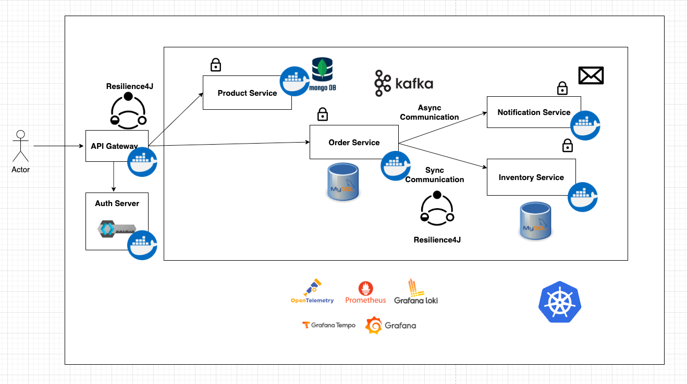

# Spring Boot Microservices
This repository contains the source code for the spring-boot-microservices guide

## Application Architecture

## Getting Started

### Commands
1. Run the application - `kubectl apply -R -f k8s/`
2. Verify it's status is "Running" - `kubectl get pods`

### Prerequisites
- Running Kubernetes cluster (Minikube, Docker Desktop, or any cloud provider)
